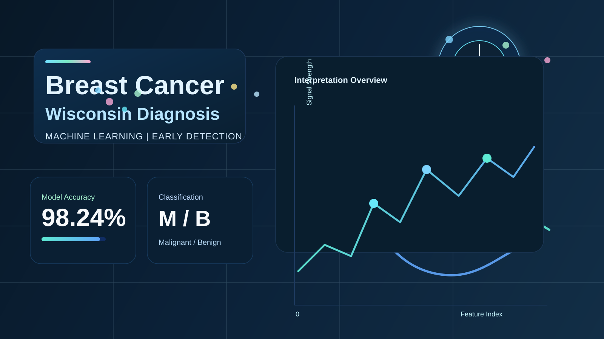
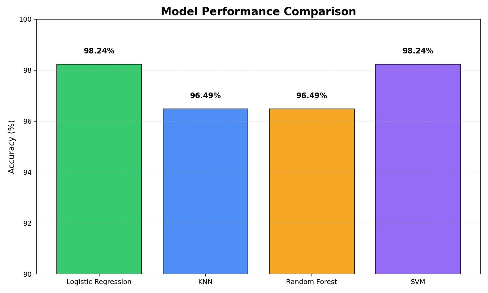
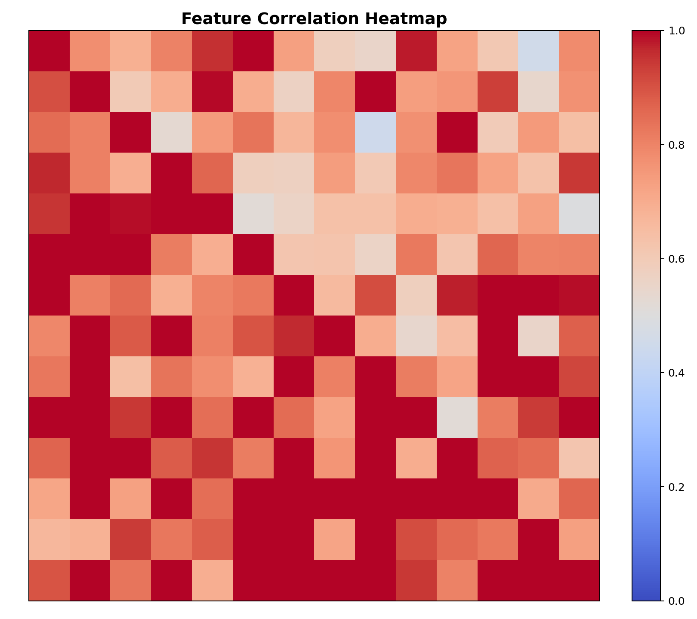

# Breast Cancer Wisconsin Diagnosis




A machine learning project that classifies breast tumors as malignant or benign using the Breast Cancer Wisconsin (Diagnostic) dataset. The notebook focuses on exploratory data analysis, preprocessing, feature engineering, and comparing multiple classification models to identify the best-performing approach.

## Table of Contents

- [Overview](#overview)
- [Project Goals](#project-goals)
- [Dataset](#dataset)
- [Project Structure](#project-structure)
- [Technologies Used](#technologies-used)
- [Installation](#installation)
- [Usage](#usage)
- [Model Comparison](#model-comparison)
- [Results](#results)
- [Links](#links)

## Overview

This project analyzes diagnostic measurements from breast mass images and predicts whether a tumor is cancerous. The workflow includes:

- Data cleaning and preprocessing
- Exploratory data analysis (EDA)
- Correlation and feature visualizations
- Train/test splitting
- Model evaluation using multiple classifiers
- Comparison of model accuracy and performance

## Project Goals

- Build a reliable breast cancer prediction model
- Explore the dataset and identify meaningful patterns
- Compare Logistic Regression, K-Nearest Neighbors, Random Forest, and SVM
- Present a clean and understandable machine learning workflow

## Dataset

The project uses the Breast Cancer Wisconsin (Diagnostic) dataset from the UCI Machine Learning Repository.

- Source: [UCI Breast Cancer Wisconsin (Diagnostic) dataset](https://archive.ics.uci.edu/dataset/17/breast+cancer+wisconsin+diagnostic)
- Data Type: Tabular medical dataset
- Target: Binary classification (`M` = malignant, `B` = benign)
- Features: 30 numerical measurements derived from cell nuclei

## Project Structure

```text
Breast Cancer Wisconsin Diagnosis/
├── Breast_Cancer.ipynb        # Main analysis notebook
├── main.py                    # Sample Python entry point
├── pyproject.toml             # Project configuration
├── requirement.txt            # Dependency list
├── uv.lock                    # Dependency lock file
├── images/
│   ├── project-banner.svg       # README header image
│   ├── model-performance.png    # Accuracy chart
│   └── feature-correlation.png  # Feature correlation visual
└── README.md                  # Project documentation
```

## Technologies Used

- Python 3.13
- Jupyter Notebook
- Pandas
- NumPy
- Matplotlib
- Seaborn
- Scikit-learn

## Installation

1. Clone the repository:

```bash
git clone https://github.com/your-username/your-repository.git
cd "Breast Cancer Wisconsin Diagnosis"
```

2. Create a virtual environment (optional but recommended):

```bash
python -m venv .venv
```

1. Activate the environment:

On Windows:

```bash
.venv\Scripts\activate
```

On macOS/Linux:

```bash
source .venv/bin/activate
```

1. Install dependencies:

```bash
pip install -r requirement.txt
```

## Usage

Open the notebook in Jupyter:

```bash
jupyter notebook
```

Then open:

- [Breast_Cancer.ipynb](./Breast_Cancer.ipynb)

You can also run:

```bash
python main.py
```

## Model Comparison

The notebook compares several classification models to find the best-performing one for this dataset.



| Model | Accuracy |
| --- | ---: |
| Logistic Regression | 98.24% |
| K-Nearest Neighbors (KNN) | 96.49% |
| Random Forest | 96.49% |
| Support Vector Machine (SVM) | 98.24% |

## Results

The final evaluation shows that both Logistic Regression and SVM achieved the best performance, with an accuracy of 98.24%.

This indicates the model is highly effective in distinguishing malignant and benign tumors based on the provided medical measurements.



## Links

- [GitHub Repository](https://github.com/your-username/your-repository)
- [Notebook](./Breast_Cancer.ipynb)
- [Dataset Source](https://archive.ics.uci.edu/dataset/17/breast+cancer+wisconsin+diagnostic)
- [Python Official Website](https://www.python.org/)
- [Jupyter Notebook](https://jupyter.org/)
- [scikit-learn](https://scikit-learn.org/)

## License

This project is intended for educational and research purposes. Add your preferred license if you plan to publish it publicly on GitHub.

## Acknowledgments

- UCI Machine Learning Repository
- Breast Cancer Wisconsin Diagnostic dataset contributors
- Open-source Python ecosystem for data science and machine learning tools
