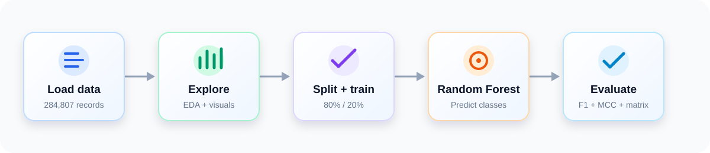
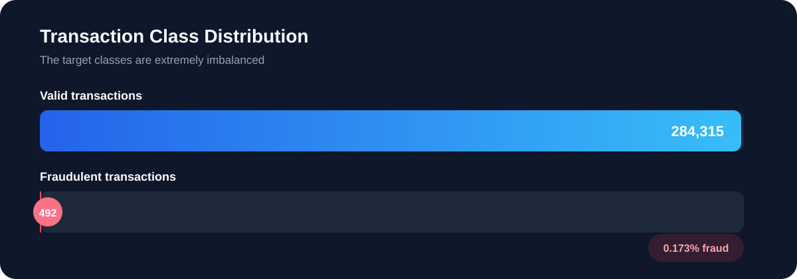

# Credit Card Fraud Detection

<p align="center">
  
</p>


A machine learning project that explores credit card transaction data and uses a Random Forest classifier to distinguish fraudulent transactions from valid ones. The notebook covers exploratory data analysis, class-distribution analysis, correlation visualization, train/test splitting, model training, and classification metrics.

<p align="center">
  
</p>

## Table of Contents

- [Overview](#overview)
- [Dataset](#dataset)
- [Project Structure](#project-structure)
- [Technologies Used](#technologies-used)
- [Installation](#installation)
- [Usage](#usage)
- [Workflow](#workflow)
- [Results](#results)
- [Limitations](#limitations)
- [License](#license)

## Overview

Credit card fraud detection is challenging because fraudulent activity is extremely rare and the dataset is highly imbalanced. This project demonstrates an end-to-end exploratory and modeling workflow, including:

- Loading and inspecting transaction records
- Comparing valid and fraudulent transaction amounts
- Visualizing feature correlations
- Separating features from the `Class` target
- Splitting data into training and testing sets
- Training a Random Forest classifier
- Evaluating predictions with common classification metrics

## Dataset

The notebook is configured for the **Credit Card Fraud Detection** dataset published on Kaggle.

- Source: [Kaggle - Credit Card Fraud Detection](https://www.kaggle.com/datasets/mlg-ulb/creditcardfraud)
- Data file: `creditcard.csv`
- Records: 284,807 transactions
- Fraudulent transactions: 492
- Valid transactions: 284,315
- Target column: `Class`
  - `0` = valid transaction
  - `1` = fraudulent transaction

`Time`, `Amount`, and the anonymized PCA features `V1` through `V28` are used as input features. The severe class imbalance makes accuracy alone an incomplete measure of model quality.

<p align="center">
  
</p>

> **Download required:** `creditcard.csv` is not included in this repository. Download it from Kaggle and place it in the project folder before running the notebook.

## Project Structure

```text
Credit Card Fraud Detection/
├── Credit_Card_Fraud_Detection.ipynb  # Analysis and model notebook
├── main.py                            # Python entry point
├── pyproject.toml                     # Project configuration
├── requirement.txt                    # Core dependency list
├── uv.lock                            # uv dependency lock file
├── images/
│   ├── project-banner.svg             # README banner
│   ├── project-workflow.svg           # Workflow infographic
│   └── data-distribution.svg          # Class distribution infographic
└── README.md                          # Project documentation
```

## Technologies Used

- Python 3.13
- Jupyter Notebook
- Pandas
- NumPy
- Matplotlib
- Seaborn
- Scikit-learn

## Installation

### Option 1: Using uv

From the repository root:

```powershell
cd "Credit Card Fraud Detection"
uv sync
uv add scikit-learn jupyter
```

### Option 2: Using pip

Create and activate a virtual environment:

```powershell
cd "Credit Card Fraud Detection"
py -3.13 -m venv .venv
.venv\Scripts\Activate.ps1
```

Install the required packages:

```powershell
pip install -r requirement.txt scikit-learn jupyter
```

On Command Prompt, activate the environment with:

```bat
.venv\Scripts\activate.bat
```

## Usage

1. Download `creditcard.csv` from Kaggle.
2. Place `creditcard.csv` next to `Credit_Card_Fraud_Detection.ipynb`.
3. Start Jupyter:

```powershell
jupyter notebook
```

4. Open [Credit_Card_Fraud_Detection.ipynb](./Credit_Card_Fraud_Detection.ipynb) and run the cells from top to bottom.

The current `main.py` file is a basic project entry point:

```powershell
python main.py
```

## Workflow

The notebook performs the following steps:

1. **Data loading:** Reads `creditcard.csv` with Pandas.
2. **Descriptive analysis:** Displays dataset statistics and compares transaction classes.
3. **Imbalance analysis:** Calculates the fraud ratio and lists fraud/valid case counts.
4. **Amount analysis:** Summarizes transaction amounts for each class.
5. **Correlation analysis:** Generates a correlation heatmap for the dataset features.
6. **Data preparation:** Splits the data into 80% training and 20% testing sets.
7. **Model training:** Fits a `RandomForestClassifier`.
8. **Evaluation:** Measures the predictions using:
   - Accuracy
   - Precision
   - Recall
   - F1-score
   - Matthews correlation coefficient
   - Confusion matrix

## Results

The notebook calculates fraud and valid transaction counts and provides a Random Forest confusion matrix and multiple evaluation metrics. Because the data is highly imbalanced, precision, recall, F1-score, and Matthews correlation coefficient are more informative than accuracy alone.

The exact metric values depend on the installed library versions and the data split. Re-run the final notebook cell to generate the current metrics and confusion matrix.

## Limitations

- Accuracy can be misleading for an imbalanced dataset.
- The notebook does not implement cross-validation or hyperparameter tuning.
- Fraud and valid samples are not resampled or weighted.
- The anonymized features limit direct interpretability of individual results.
- The model is intended for educational analysis and not as a standalone production fraud-prevention system.

## License

This project is intended for educational and research purposes. Add a license before publishing or distributing the project publicly.